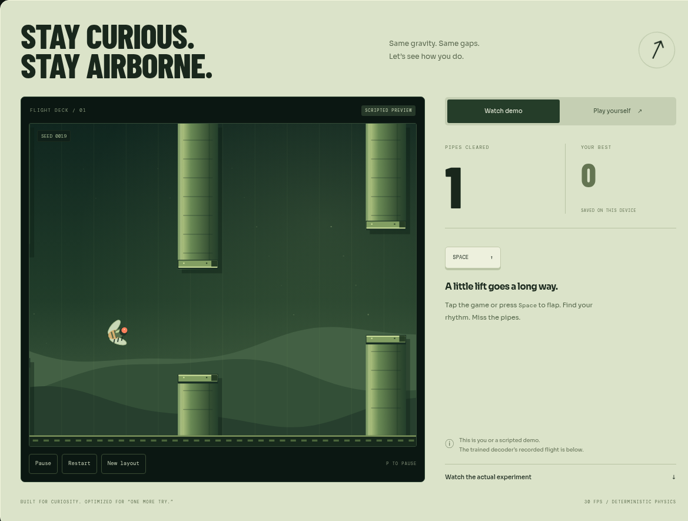
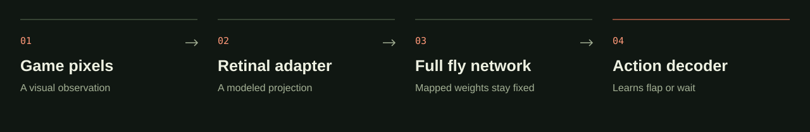

# Flappy Fly

[](https://github.com/jackspiece/flappy-fly/actions/workflows/checks.yml)

What happens when a fruit fly's mapped wiring is put in front of Flappy Bird?

Flappy Fly puts the complete retained MaleCNS network inside an approximate spiking
simulator, shows it game frames, and trains a small action decoder from its neural
activity. The code, failures, checkpoints, and measurements are all public in this
repository.

[Play the arcade](https://jackspiece.github.io/flappy-fly/) ·
[Watch a decoder flight](https://jackspiece.github.io/flappy-fly/#learning) ·
[Read the method](notes/LEARNING.md) · [Contribute](CONTRIBUTING.md)

## Where it stands

Status on September 11, 2026: the full map runs on a standard GitHub CPU runner, and two
decoder pilots have completed. Pilot 02's decoder never reached a pipe. On all three
unseen test layouts, its flight ended at frame 58, before the first pipe can reach the
fly (about frame 87). It survived fewer frames than random flapping (mean 75.3) or
periodic flapping (87.0). In the recorded flight, it flaps twice and falls into the
ground. The first reliable flight is still an open problem.

The mapped synaptic weights stay fixed in these pilots. Learning happens in the decoder.
This is not a reconstruction of a living fly, and it does not yet show that fly wiring
is better than simpler AI.

## Play it

<a href="https://jackspiece.github.io/flappy-fly/#arcade">
  
</a>

[Play in your browser](https://jackspiece.github.io/flappy-fly/#arcade). Tap or press
Space to flap, and press P to pause. You can switch to another seeded layout and try to
beat your own best score.

The main arcade uses manual controls or a scripted demo. The separate
[recorded decoder flight](https://jackspiece.github.io/flappy-fly/#learning) replays an
actual evaluation. The full neural simulator runs in Python and C++.

## How it works



| Part              | What it does                                                                                                       |
| ----------------- | ------------------------------------------------------------------------------------------------------------------ |
| Observation       | High-contrast game pixels drive an explicit retinal adapter.                                                       |
| Full retained map | Simulates 166,700 neurons and 25,582,938 directed, weighted connections.                                           |
| Features          | Photoreceptor spike grids, anatomical population rates, activity changes, and the controller's own action history. |
| Learning          | A 48-unit hidden-layer decoder learns flap or wait through imitation and dataset aggregation.                      |
| Evaluation        | Separate training, validation, and test layouts; the first test seed always supplies the replay.                   |

Bird position, pipe coordinates, velocity, and the teacher's decision do not enter the
decoder inputs. The privileged teacher supplies training labels.

"Full" refers to the upstream retained network: assigned neuronal superclasses,
including weak and self connections, excluding glia and unresolved objects. It does not
mean every object in the raw reconstruction. The visual adapter, dynamics, and decoder
are modeling choices.

[Read the learning method](notes/LEARNING.md) · [Inspect the neural source](fly_neural/)
· [Check the data provenance](notes/CREDITS.md)

## Pilot results

The latest pilot collected 6,212 full-network training examples. The selected checkpoint
was fitted on 5,292 examples, chosen using policy-validation layouts before the three
held-out tests.

| Controller                         | Mean pipes | Mean frames alive |
| ---------------------------------- | ---------: | ----------------: |
| Learned decoder, pilot 02          |       0.00 |              58.0 |
| Random flaps                       |       0.00 |              75.3 |
| Periodic flaps                     |       0.00 |              87.0 |
| Scripted teacher, privileged state |       9.00 |             600.0 |

Seeds: 9101, 9102, 9103. Each episode is capped at 600 frames. The teacher has access to
game state that the decoder never sees, so its score is only a reference point. Three
layouts are only a preliminary check.

- [Pilot 02: report, checkpoint, and replay](experiments/pilot-02/)
- [Pilot 01: the original result, unchanged](experiments/pilot-01/)
- [Experiment log and interpretation](experiments/README.md)
- [Completed learning run](https://github.com/jackspiece/flappy-fly/actions/runs/34625990529)

## Runtime on a small machine

Measured on a standard Ubuntu x86-64 GitHub runner, with no GPU:

| Measurement                            |                  Result |
| -------------------------------------- | ----------------------: |
| Retained neurons                       |                 166,700 |
| Directed, weighted connections         |              25,582,938 |
| Core graph arrays                      |              196.45 MiB |
| Peak neural-process RAM                |   930.78 MiB / 0.91 GiB |
| Peak preparation child-process RAM     | 1,596.76 MiB / 1.56 GiB |
| Mean wall time per 10 ms neural window |                27.41 ms |
| Original benchmark workflow duration   |              48 seconds |

Six timed samples after 100 ms of warmup, with learning disabled. These numbers show
that the full map can run on such a machine. They say nothing about training convergence
or sustained throughput.

[Raw measurements and tested commit](benchmarks/2026-09-11-github/) ·
[Inspect individual samples](https://jackspiece.github.io/flappy-fly/#evidence) ·
[Benchmark run](https://github.com/jackspiece/flappy-fly/actions/runs/34622807743)

## Run it yourself

### Preview the arcade

The site has no runtime dependencies or build step:

```sh
git clone https://github.com/jackspiece/flappy-fly.git
cd flappy-fly
python -m http.server 8000 --directory docs
```

Open http://localhost:8000. The arcade works on phones and desktops, supports keyboard
and touch, respects reduced motion, and keeps your best score on your device.

### Reproduce the full-network pilot

Use Linux or macOS (on Windows, use WSL2) with Python 3.12+, a C++17 compiler available
as `c++`, and the packages below. The pipeline imports Python's Unix-only `resource`
module and builds its native kernel as a `.so` or `.dylib` library, so it does not run
on native Windows. Data preparation downloads about 1.11 GB and needs additional working
space. Source files and compiled arrays are verified against pinned hashes.

```sh
python -m pip install -r requirements.txt
python -m unittest discover -s tests -v
python scripts/prepare_data.py
python scripts/benchmark.py
python scripts/train_pilot.py --wall-seconds 720 --rounds 2 --seed-offset 100
```

For an archived pilot, use the source commit in its `run.json`; feature schemas can
change. Checkpoints are loaded with `allow_pickle=False`.

The manual Learning pilot and Full fly map benchmark workflows run on GitHub Actions
with a 20-minute job limit. Learning uploads reports and checkpoints; the large dataset
stays out of the repository. Ordinary CI runs small verification checks without
downloading the full map.

<details>
<summary>Run the small synthetic integration check</summary>

```sh
python scripts/benchmark.py --synthetic --output results/synthetic-scale.json
```

This deliberately synthetic graph exercises storage and the native integration. Its
runtime does not predict the real network's runtime.

</details>

## What to try next

Useful next experiments include testing what the retina retains, comparing matched
simpler and shuffled networks, and evaluating across more held-out layouts. Better
decoder classification alone is not enough: the controller has to stay airborne.

If you have a hypothesis,
[propose an experiment](https://github.com/jackspiece/flappy-fly/issues/new/choose). To
improve the arcade or reproduce a result, start with [CONTRIBUTING.md](CONTRIBUTING.md).

```text
docs/          The playable arcade and measured-result explorer
flappy_fly/    Deterministic game, neural adapter, and decoder
fly_neural/    Pinned upstream neural source and provenance
scripts/       Data preparation, training, and verification
experiments/   Archived pilot reports, checkpoints, and replays
benchmarks/    Recorded full-map runtime measurements
```

## Credits

The MaleCNS release comes from HHMI Janelia, Google Research, and their collaborators.
Neural simulation code is pinned from
[`nftechie/stonkfly`](https://github.com/nftechie/stonkfly) at
`78ef3e05ab0fa086032098558d893667068944a0`, with its MIT attribution retained. Flappy
Fly is an independent community experiment.

[Complete credits, data sources, and licenses](notes/CREDITS.md)

## License

The original Flappy Fly code is released under the [MIT License](LICENSE). Third-party
material keeps its own license:

- `fly_neural/` is pinned upstream code from `nftechie/stonkfly` and keeps its upstream
  MIT license, copyright 2026 nftechie and DOOMFLY contributors
  ([UPSTREAM_LICENSE](fly_neural/UPSTREAM_LICENSE)).
- The self-hosted fonts in `docs/assets/fonts/` are under the SIL Open Font License 1.1;
  each font ships with its license text.
- The MaleCNS v1.0 connectome data is licensed under
  [CC BY 4.0](https://creativecommons.org/licenses/by/4.0/). The pipeline downloads the
  release files at run time and verifies them against
  [`fly_neural/sources.lock.json`](fly_neural/sources.lock.json); they are not stored in
  this repository.
